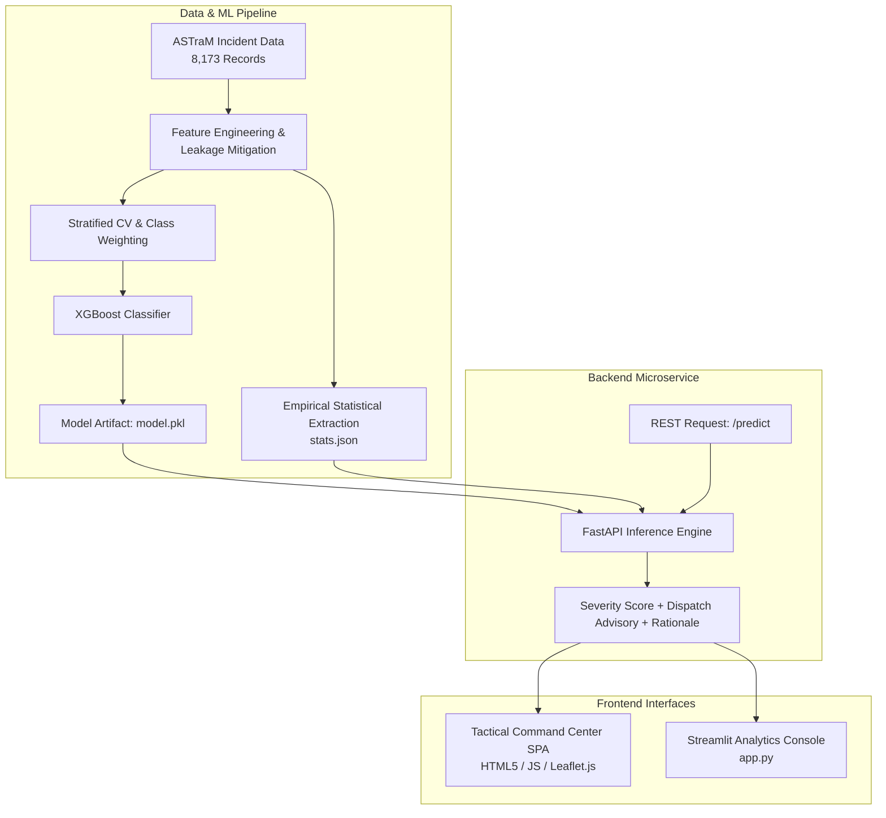

# 🚦 ASTraM Traffic Command Center — Predictive Dispatch & GIS Intelligence

[](https://python.org)
[](https://fastapi.tiangolo.com)
[](https://xgboost.ai)
[](https://leafletjs.com)
[](LICENSE)

An end-to-end Machine Learning and Geospatial Decision Support System designed for urban traffic management and police dispatch in Bengaluru. Built upon **8,173 real ASTraM traffic incidents**, the system forecasts incident severity and generates data-backed, prescriptive enforcement recommendations (officers, barricades, dynamic corridor diversions, and clearance estimates).

---

## 📌 Executive Summary

Urban traffic congestion response is typically reactive. Dispatchers often guess staffing requirements, resulting in either under-staffed bottlenecks or misallocated patrol units.

This platform bridges **predictive machine learning** with **prescriptive operational analytics**:
1. **Severity Classification:** Predicts whether an event escalates to `High` congestion impact based on root cause, temporal factors, vehicle involvement, and spatial zones.
2. **Leakage-Free Feature Engineering:** Eliminates corridor target proxying present in municipal dispatch logs to ensure real-world generalizability.
3. **Prescriptive Dispatch Advisory:** Translates predictions and empirical historical distributions into deterministic resource sizing without generative hallucinations.
4. **Geospatial Tactical Map:** Visualizes bottleneck hotspots, arterial corridors, and diversion points across Bengaluru.

---

## 🏗️ System Architecture



---

## 🔬 Machine Learning Pipeline

### 1. Leakage Diagnosis & Mitigation
In the raw ASTraM incident logs, `priority == 'High'` correlated almost perfectly with `corridor != 'Non-corridor'`, creating a target proxy artifact. A naive classifier achieves artificial 98%+ accuracy by simply memorizing corridor labels. To build a robust model capable of predicting severity before corridor escalation is confirmed, `corridor` was intentionally excluded from the predictor set.

### 2. Feature Set
- **Categorical (Ordinal Encoded):** `event_cause`, `veh_type`, `zone`, `hour_bucket` (binned into Night, Morning Peak, Daytime, Evening Peak, Late Night).
- **Temporal & Environmental:** `day_of_week`, `is_weekend`, `month`.
- **Operational Flags:** `event_type` (Planned vs Unplanned), `requires_road_closure`, `is_high_risk_cause` (`breakdown`, `construction`, `water_logging`, `congestion`, `accident`).

### 3. Training & Validation
- **Model:** Gradient Boosted Decision Trees (`XGBClassifier`, 300 estimators, max depth 5).
- **Imbalance Handling:** `scale_pos_weight` set dynamically to class frequency ratio.
- **Validation Scheme:** Stratified 5-Fold Cross Validation.

| Metric | Cross-Validation Score | Test Split Score |
| :--- | :--- | :--- |
| **Accuracy** | 68.0% | 68.01% |
| **F1-Score (Macro)** | 0.732 ± 0.015 | 0.7317 |
| **High Severity Recall** | 76.4% | 76.8% |

> *Note on Accuracy:* In municipal dispatch data, human incident reporting incorporates high real-world variance. Given the asymmetry of incident costs (a missed major bottleneck costs hours of city gridlock), the model prioritizes **Recall on High-Severity events** over simple accuracy.

---

## 📊 Prescriptive Decision Engine

The system does not use open-ended LLMs for operational sizing. Resource allocation is derived deterministically from the empirical conditional distributions in `stats.json`:

$$\text{Officers}_{\text{Base}} = 10 + \left(\frac{\text{Historical High Rate}_{\text{cause}}}{100}\right) \times 20$$

$$\text{Officers}_{\text{Final}} = \min\left(50, \ \text{Officers}_{\text{Base}} \times (0.5 + P(\text{High})) \times (1.4 \text{ if closure else } 1.0)\right)$$

- **Barricades:** Dynamically scaled by road closure requirement and root-cause historical closure rates.
- **Diversions & ETA:** Computed from historical clearing duration percentiles conditioned on `(event_cause, severity)`.
- **Explainability:** Returns exact data-backed justifications (e.g., *"Historical High-severity rate of 62.9% across 480 construction incidents"*).

---

## 📁 Repository Structure

```text
├── backend/
│   └── main.py              # FastAPI REST service & decision rules
├── frontend/
│   └── app.py               # Streamlit interactive dashboard
├── web_ui/
│   └── index.html           # Command Center SPA with Leaflet GIS map
├── data_pipeline.py         # Data preprocessing and feature extraction
├── train_model.py           # Model training, CV evaluation, and stats export
├── dataset_processed.csv    # Anonymized dataset of 8,173 ASTraM events
├── model.pkl                # Serialized XGBoost pipeline
├── stats.json               # Extracted empirical lookup tables
├── test_live.py             # Automated API integration tests
└── requirements.txt         # Project dependencies
```

---

## ⚡ Quick Start

### 1. Clone & Set Up Environment
```bash
git clone https://github.com/rkesanchay03/ML_traffic.git
cd ML_traffic

# Create virtual environment
python -m venv venv

# Activate virtual environment
# Windows:
venv\Scripts\activate
# Linux/macOS:
source venv/bin/activate

# Install dependencies
pip install -r requirements.txt
```

### 2. Retrain Model (Optional)
```bash
python train_model.py
```
*Generates updated `model.pkl` and `stats.json` from `dataset_processed.csv`.*

### 3. Launch the Backend API
```bash
python -m uvicorn backend.main:app --host 127.0.0.1 --port 8000 --reload
```
- Swagger API Docs: [http://127.0.0.1:8000/docs](http://127.0.0.1:8000/docs)
- Health Check: [http://127.0.0.1:8000/health](http://127.0.0.1:8000/health)

### 4. Launch the Command Center UI

**Option A: Modern Tactical Command Center (Recommended)**
```bash
cd web_ui
python -m http.server 3000
```
Open [http://localhost:3000](http://localhost:3000) in your browser.

**Option B: Streamlit Dashboard**
```bash
streamlit run frontend/app.py
```

---

## 📡 API Specification

### Endpoint: `POST /predict`

#### Sample Request:
```json
{
  "event_cause": "vehicle_breakdown",
  "event_type": 0,
  "requires_road_closure": 1,
  "veh_type": "heavy_vehicle",
  "hour_of_day": 19,
  "day_of_week": 1,
  "is_weekend": 0,
  "month": 3,
  "zone": "North Zone 2",
  "corridor": "Tumkur Road"
}
```

#### Sample Response:
```json
{
  "severity": "HIGH",
  "confidence": 78.4,
  "prob_high": 78.4,
  "prob_low": 21.6,
  "manpower": {
    "officers": 26,
    "barricades": 20,
    "basis": "Based on 58.2% historical high-priority rate for 'vehicle_breakdown'"
  },
  "diversions": {
    "count": 2,
    "avg_duration_min": 142,
    "basis": "Avg resolution time from historical dataset"
  },
  "importances": [
    {"feature": "Zone", "value": 14.3},
    {"feature": "Requires Road Closure", "value": 11.8},
    {"feature": "High-Risk Cause Flag", "value": 11.2}
  ],
  "rationale": [
    "'vehicle_breakdown' has a 58.2% historical High-severity rate.",
    "Hour 19:00 is within peak congestion windows.",
    "Road closure requested: triggers full barricading protocol."
  ],
  "model_info": {
    "accuracy": 0.6801,
    "f1_score": 0.7317,
    "trained_on": "ASTraM Bengaluru Event Dataset (8,173 events)"
  }
}
```

---

## 🛣️ Roadmap & Future Enhancements
- [ ] Implement Target Encoding / native categorical trees in place of Ordinal Encoding.
- [ ] Integrate TomTom or Google Maps Live Traffic APIs for real-time corridor congestion baseline comparison.
- [ ] Package multi-container deployment via Docker Compose.
- [ ] Add SHAP waterfall explainability endpoint directly into UI modal.

---

## 👤 Author
**Sanchay** — [GitHub Profile](https://github.com/rkesanchay03)
